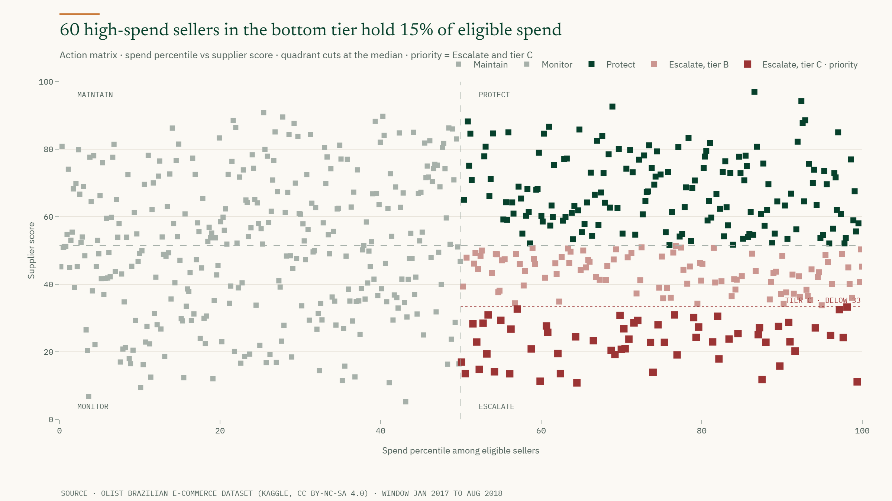
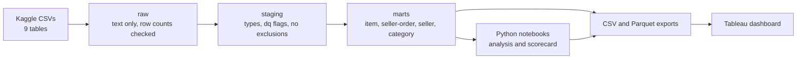
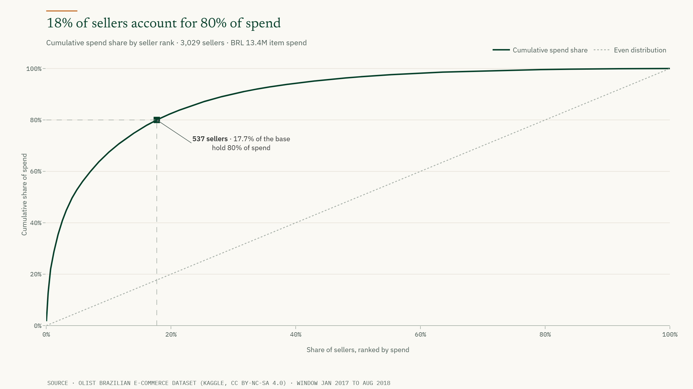
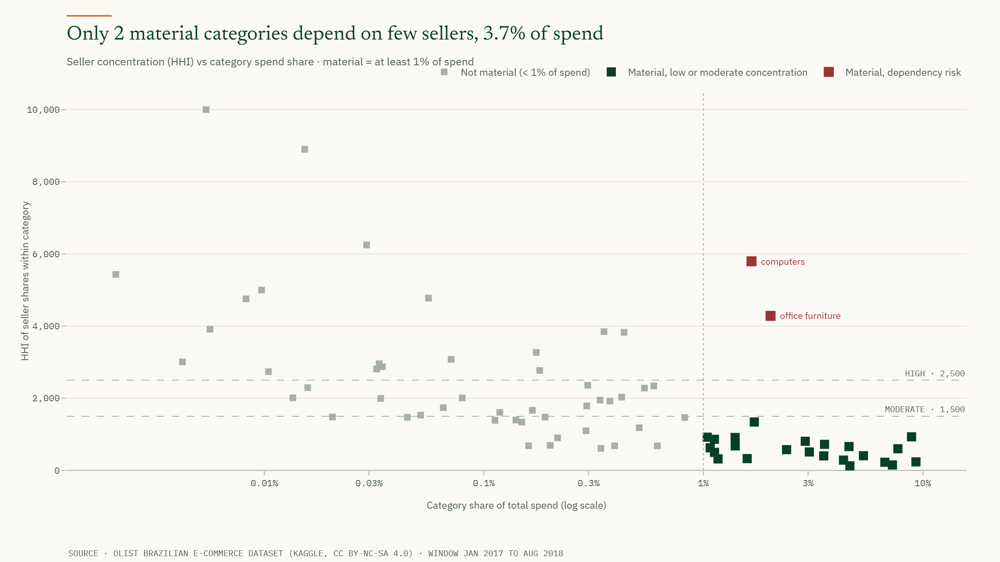
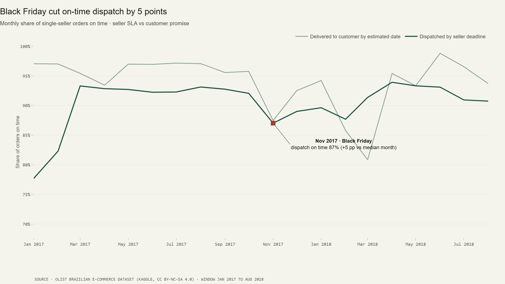
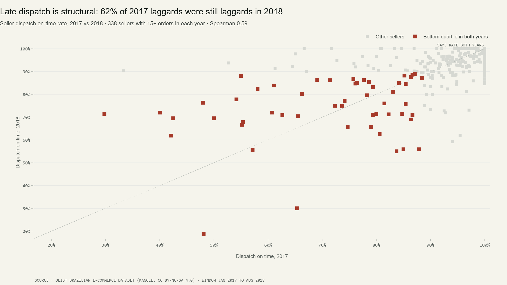
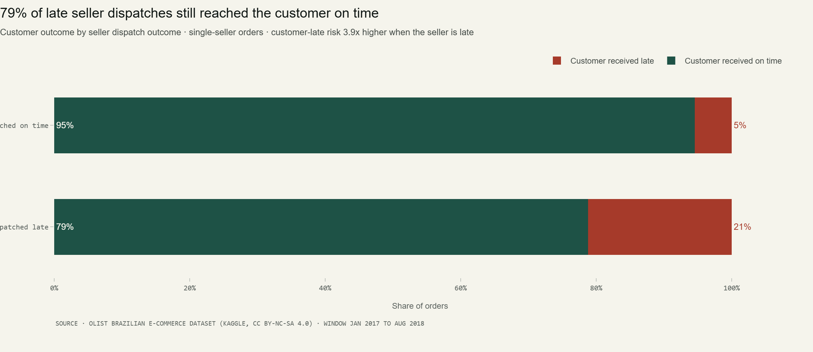
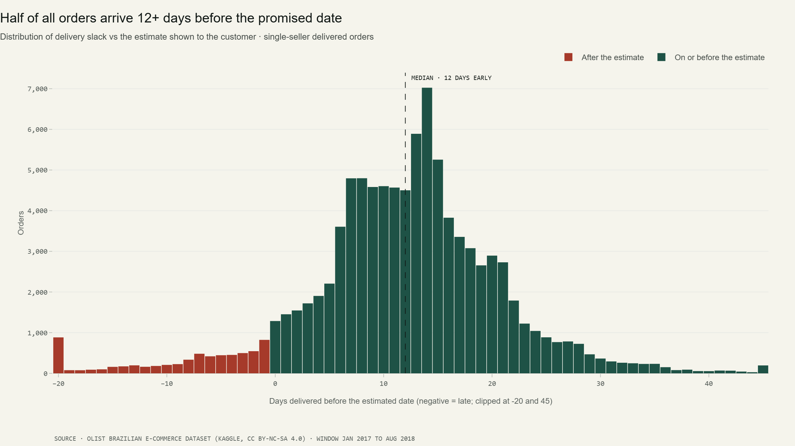
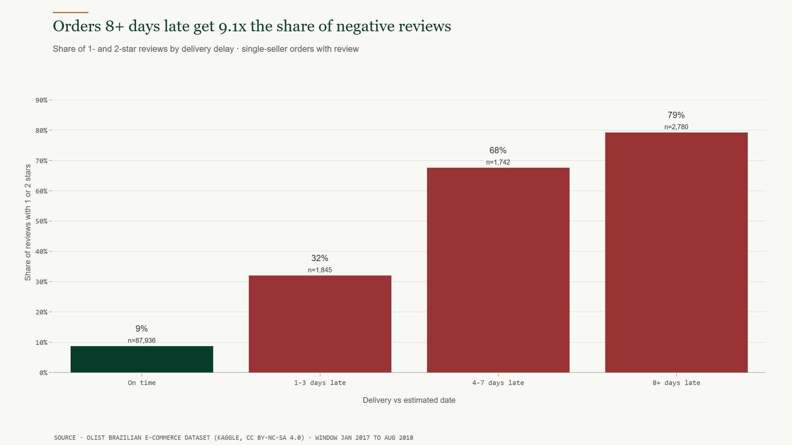
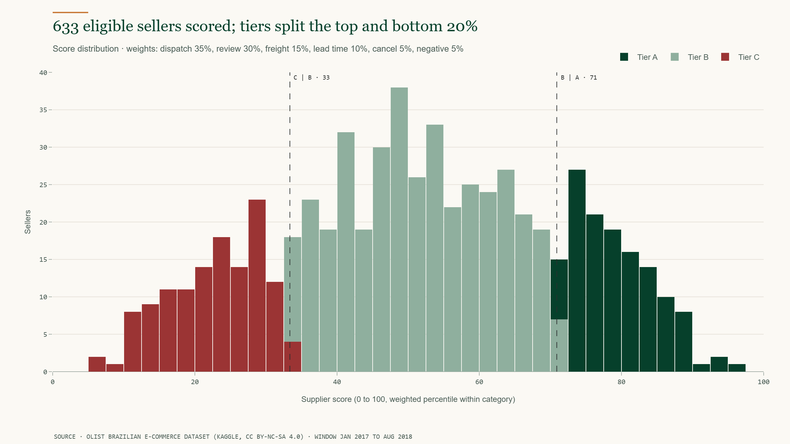

# Procurement analytics on Olist

Spend concentration, seller dispatch performance and a supplier scorecard, built with SQL (DuckDB) and Python on 99k public marketplace orders.

`SQL` `DuckDB` `Python` `pandas` `Plotly` `pytest`

**Dashboard:** [Tableau Public, link added at publication] · **Notebook:** [Kaggle](https://www.kaggle.com/code/stephanyalveseng/procurement-lens-on-olist-supplier-scorecard) · **Scorecard version:** [`scorecard-v1`](../../tree/scorecard-v1)

---

## TL;DR

- **17.7% of sellers hold 80% of spend**, but supplier dependency is a category problem, not a portfolio problem: spend-weighted HHI is 788 (low) and only two material categories, 3.7% of spend, depend on a single dominant seller.
- **Measuring suppliers at delivery hides their failures.** 78.8% of orders a seller dispatched late still reached the customer on time, because the median order arrives 12 days before the promised date. Late dispatch is also structural: 62% of the 2017 bottom-quartile sellers were still there in 2018, against 25% expected by chance.
- **A scorecard of 633 sellers (77.1% of spend) narrows action to a shortlist of 60** with high spend and bottom-tier performance (14.7% of eligible spend). Their problem is reliability, not cost: 77.7% dispatch on time against 95.0% for all eligible sellers, with lower freight than average.



---

## Context and framing

[Olist](https://www.kaggle.com/datasets/olistbr/brazilian-ecommerce) is a Brazilian marketplace. This project reads it through a procurement lens: **Olist is treated as the buying organization and its 3,000+ sellers as the supplier base.** Item price stands for spend, the seller's shipping deadline for the supplier's delivery commitment, and the customer review for perceived quality.

The adaptation is deliberate and has limits. Sellers are not contracted suppliers, there are no purchase orders or negotiated prices, and the buyer here does not choose who fulfils each order. What transfers well is the analytical method: concentration and dependency analysis, supplier SLA measurement, separating supplier delay from logistics delay, and a weighted scorecard that ends in a decision.

## Business questions

| | Question | Answered in |
| --- | --- | --- |
| Q1 | How concentrated is spend, and in which categories does the buyer depend on few sellers? | `notebooks/02_spend_concentration.ipynb` |
| Q2 | Which sellers miss their dispatch deadline, and is it structural or circumstantial? | `notebooks/03_delivery.ipynb` |
| Q3 | How much of the delay the customer feels is the seller's, and how much is the logistics leg's? | `notebooks/03_delivery.ipynb` |
| Q4 | How do delay and distance relate to reviews and freight cost? | `notebooks/03_delivery.ipynb` |
| Q5 | Which sellers are best and worst within their category, and where should procurement act first? | `notebooks/04_scorecard.ipynb` |

## Data and method

**Source.** Brazilian E-Commerce Public Dataset by Olist, 9 tables, CC BY-NC-SA 4.0. **Window:** January 2017 to August 2018 (20 months, 99,092 orders); September to December 2016 and September to October 2018 were excluded because monthly volume was too low for stable rates (349 orders, 0.35%).



| Layer | What it does | Checked by |
| --- | --- | --- |
| `sql/00_raw` | Loads every CSV as text, so type errors surface later and get counted | `src/check_raw.py`: row counts match the source for all 9 tables |
| `sql/01_staging` | Types, standardization, English category names, one review per order, median coordinate per zip prefix, `dq_` flags. Flags, never excludes | `tests/test_staging.py` (20 tests); flag counts match `docs/data_quality.md` |
| `sql/02_marts` | Business rules: item fact, seller-order fact, seller dimension, monthly seller metrics, category concentration, scorecard base | `tests/test_marts.py` (18 tests): unique grain, spend reconciles across layers to the cent, rates in range |
| `notebooks/` | Analysis, scorecard, figures and exports | Each notebook opens by reconciling with the marts |

**Two modelling decisions that change the numbers**

1. **Rates are computed per seller-order, not per item.** At item grain an order with five items would weigh five times in a seller's delivery and review rates.
2. **Exclusions are applied per metric, not globally.** Multi-seller orders (1.3%) are kept in spend but excluded from delivery and review metrics, because dates and reviews belong to the order, not to one seller. Every rule and the share of records it affects is in [`docs/data_quality.md`](docs/data_quality.md).

## Findings

Full list with denominators and implications: [`docs/findings.md`](docs/findings.md).

### Q1 · Spend is concentrated in sellers, not in categories



537 of 3,029 sellers (17.7%) account for 80% of BRL 13.4M item spend. At category level, spend-weighted HHI is 788. Two material categories (at least 1% of spend) show single-source dependency: **computers** (9 sellers, top seller 75%) and **office furniture** (34 sellers, top seller 64%), together 3.7% of spend. The two need different actions: office furniture already has alternative sellers, so the lever is reallocating volume; in computers the base itself is narrow, so the lever is developing new sources. The result holds for materiality cuts of 0.5%, 1% and 2%.



Categories above HHI 2,500 hold only 5.1% of spend: ranking categories by HHI alone would send sourcing effort to categories that carry little money.

### Q2 · Late dispatch is structural, and peaks expose it



Sellers dispatch 92.2% of orders on time in the median month. In November 2017 (Black Friday, 1.6x median volume) the rate fell to 87.0%. Between the two years, 62% of the 2017 bottom-quartile sellers stayed in the bottom quartile (Spearman 0.59, 338 sellers with 15+ orders in each year), so a seller's past dispatch rate predicts its future one.



### Q3 · Delivery-date metrics hide supplier failures



When the seller dispatches late, the customer is late 3.9x as often (21.2% vs 5.5%). Yet 78.8% of late dispatches still arrive on time, because delivery estimates carry a median of 12 days of slack. The seller was also late in only 27.8% of the orders that reached the customer late, so most customer delay starts in the logistics leg. **Supplier performance has to be measured at the hand-off the supplier controls.**



### Q4 · Lateness drives reviews; distance is a logistics problem



9% of on-time orders get a 1- or 2-star review; the share is 32% at 1 to 3 days late and 79% at 8 or more. Across distance bands the seller late rate stays between 8.6% and 9.6%, while the customer late rate rises from 4.5% to 10.5% and median freight from 17% to 30% of item price: sellers should not be scored on distance-driven delay.

### Q5 · A scorecard that ends in a shortlist



633 sellers with 30+ orders (77.1% of spend) are scored. The ranking is robust: against three alternative weightings, Spearman is 0.95 to 0.97 and the top 20 overlaps by 70% to 85%. Crossing the score with spend gives **60 priority sellers** (high spend, bottom 20% of scores, 14.7% of eligible spend). For 80% of them the largest gap is dispatch on time; their median p90 dispatch lead time is 8.6 days against 4.3 for all eligible sellers, while their freight ratio is lower than average.

## Scorecard methodology

| Metric | Weight | Direction | Why it is in (or out) |
| --- | ---: | --- | --- |
| Dispatch on time (vs seller shipping limit) | 35% | Higher is better | Controlled by the seller, persistent, independent of distance |
| Review, Bayesian shrinkage (m = 20) | 30% | Higher | Perceived quality; shrinkage stops a seller with 3 five-star reviews from leading |
| Freight / item price | 15% | Lower | Total cost of sourcing from that seller |
| Dispatch lead time, p90 | 10% | Lower | Predictability, not just the average |
| Cancellation rate | 5% | Lower | Cut from 15% by a rule fixed before the result: 77.3% of eligible sellers have zero cancellations |
| Share of 1-2 star reviews | 5% | Lower | Tail of dissatisfaction |
| Delivered to customer on time | 0% | | Excluded: about 72% of customer delay starts in logistics |

- **Eligibility:** 30+ valid orders in the window. Below that, rates are noise.
- **Normalization:** each metric becomes a 0-100 percentile within the seller's main category (global percentile for categories with fewer than 5 eligible sellers, 52 sellers), so a furniture seller is compared with furniture sellers.
- **Score:** weighted average of the percentiles.
- **Tiers:** relative, A = top 20% (score ≥ 70.9), C = bottom 20% (< 33.4). A percentile-based score centres at 50 by construction, so fixed cuts would put most sellers in C.
- **Action matrix:** spend percentile vs score, cut at the median of each. **Priority = Escalate quadrant and tier C.**
- **Explainability:** every score decomposes into the contribution of each metric (notebook 04, section 7).
- **Parameters** (weights, tier cuts, shrinkage, minimum orders) are exported to `data/processed/scorecard_parameters.csv`, so the dashboard reproduces the same result.

## Limitations

- **Marketplace, not procurement data.** Sellers are not contracted suppliers and there are no negotiated prices; the method transfers, the context is an adaptation.
- **Coverage.** The scorecard covers sellers with 30+ orders: 21% of sellers and 77.1% of spend. The long tail is not scored.
- **Cancellations are understated.** 775 orders (0.78%) have no items, so they cannot be attributed to a seller.
- **Early 2017** has low volume (800 orders in January) and lower dispatch rates; monthly trends are reliable from March 2017.
- **Censoring at the end of the window** is negligible: 0.4% of August 2018 orders had no dispatch date at extraction.
- **Geolocation** uses the median coordinate of each zip prefix; distances are approximate, and 7 sellers and 278 customers have no coordinate.
- **Associations, not causes.** No finding claims that one variable causes another.

## How to reproduce

Requires Python 3.12 and a [Kaggle API token](https://www.kaggle.com/settings).

```bash
pip install -r requirements.txt
kaggle datasets download -d olistbr/brazilian-ecommerce -p data/raw --unzip
python -m src.pipeline && python -m src.check_raw && pytest -q
```

Then run the notebooks in order (`02` to `04`). `python -m src.profile_data` regenerates the data quality report and `python -m src.check_marts` prints the business sanity check. Raw data and the DuckDB file are not versioned; `data/manifest.csv` holds the SHA-256 of every source file.

## Repository structure

```
data/
  manifest.csv            source files, row counts, SHA-256
  processed/              exports for Tableau and Hugging Face (scorecard, monthly, category)
docs/
  data_quality.md         measured anomalies and the cleaning decision for each
  findings.md             findings with denominators and implications
notebooks/                02 spend concentration · 03 delivery · 04 scorecard
reports/figures/          all charts, PNG at 2x
sql/
  00_raw/                 load as text
  01_staging/             9 views, typed and flagged
  02_marts/               facts, dimension, marts, exports
src/
  pipeline.py             runs every SQL layer in order
  check_raw.py            row counts vs source
  profile_data.py         data quality report
  check_marts.py          business sanity check
  data.py, style.py       read-only data access and the chart style
tests/                    staging and mart tests (38)
```

## Next steps

- **Late-dispatch risk model.** Predict, at order level, which orders will miss the shipping limit, using only seller history known at purchase time (temporal split, no leakage). Planned for v2.
- **Tableau dashboard** for the monthly supplier review: executive overview, ranked scorecard with adjustable weights, and the action matrix. In progress.
- **dbt migration** of the SQL layers (the folder structure already follows staging and marts).

## License and attribution

- **Code:** MIT, see [`LICENSE`](LICENSE).
- **Data:** [Brazilian E-Commerce Public Dataset by Olist](https://www.kaggle.com/datasets/olistbr/brazilian-ecommerce), CC BY-NC-SA 4.0. Derived files in `data/processed/` are shared under the same license, for non-commercial use, with attribution to Olist.

**Stephany Alves** · Procurement and data analytics · [LinkedIn](https://www.linkedin.com/in/stephany-alves/) · [Kaggle](https://www.kaggle.com/stephanyalveseng)
